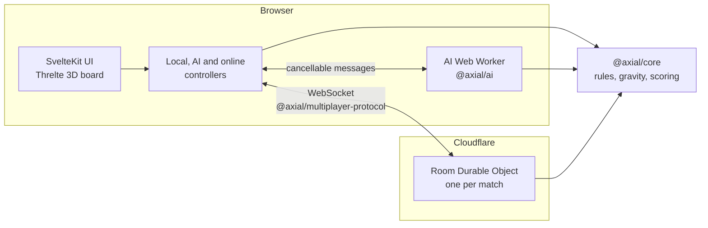

# Axial

A 3D gravity strategy game by Caden Calderon. Drop pieces into a shared board and build lines across its width, height, and depth. Play against the AI, pass the device to a friend, or invite someone to a private online match.

**[Play Axial](https://playaxial.dev)** · [Run locally](#run-locally) · [Engineering guide](axial-web/README.md) · [How it started](#how-it-started)


## The game

Axial takes the familiar idea of Connect Four into three dimensions. Pieces fall to the bottom of a column, so every move changes both the current threats and the spaces your opponent can reach next.

- **Three ways to play:** local two-player, four AI difficulties, and private online rooms with invite links and QR codes.
- **Adjustable rules:** Connect 4 or 5, different board dimensions, and one, two, or three lines needed to win. All 13 spatial line directions count.
- **A board you can explore:** orbit and zoom, preview a placement, and use keyboard controls or touch confirmation.
- **Built for another round:** saved local/AI matches, undo and move review, online reconnect, and rematches that alternate the opening player.
- **A considered interface:** interactive onboarding, light/dark themes, reduced-motion support, and optional procedural sound.

Classic is the playable ruleset. Tactical is marked “Coming soon” in the interface; its experimental rules remain in the source.

## Engineering

The application is a TypeScript workspace built with **SvelteKit, Svelte 5, Three.js, and Threlte**. The frontend runs on Cloudflare Pages; private multiplayer uses a separate Cloudflare Worker with a Durable Object per room.



The implementation separates three concerns:

- **Rules are shared.** A pure TypeScript core owns gravity, legal moves, line scoring, and replay. The browser, the AI, and the multiplayer server all use it.
- **AI stays off the UI thread.** A cancellable Web Worker runs a hybrid of Monte Carlo tree search, bounded alpha-beta lookahead, and threat evaluation. Difficulty changes the search budget and tactical behavior. The AI runs entirely in the browser: no LLM and no hosted inference.
- **Online matches have one authority.** The room server validates moves and broadcasts ordered snapshots; clients recover through reconnect and state synchronization.

For a code tour, start with the [rules engine](axial-web/packages/core/src/index.ts), [AI search](axial-web/packages/ai/src/classic/mcts.ts), [game controller](axial-web/apps/web/src/lib/game/state/gameController.svelte.ts), and [multiplayer room](axial-web/apps/multiplayer-worker/src/roomObject.ts). The [product brief](PRODUCT.md) describes the interaction and visual priorities, and the [engineering notes](dev/README.md) record the design decisions, audits, and evaluation behind each development pass.

## Run locally

Use Node **24.13.0** (pinned in `axial-web/.node-version`) and pnpm **10.32.1** (pinned in `axial-web/package.json`).

```sh
git clone https://github.com/caden-calderon/Axial.git
cd Axial/axial-web
pnpm install --frozen-lockfile
pnpm dev --host 127.0.0.1
```

Open the URL printed by Vite. Local and AI play work without accounts, API keys, or a backend. To test private Online rooms, start the local room service using the [multiplayer setup instructions](axial-web/README.md#run-locally).

## Verification

From `axial-web/`:

```sh
pnpm check
pnpm lint
pnpm test
pnpm build
```

The test command runs unit tests and Playwright browser tests against a production preview, with a local room service. Tests cover the rules engine, AI tactics and lifecycle, input and onboarding, rendered board behavior, iframe integration, and online matches. The browser suite installs Chromium and needs local ports 4173 and 8787; use a Linux environment with Chromium's system dependencies available. See the [engineering guide](axial-web/README.md#verification) for focused commands and optional AI evaluations.

## Repository map

| Path                                    | Contents                                                                            |
| --------------------------------------- | ----------------------------------------------------------------------------------- |
| [`axial-web/`](axial-web/)              | The web application, shared rules and AI packages, and the multiplayer service      |
| [`axial-video/`](axial-video/)          | Remotion project for the game's overview video, recorded from the real web app      |
| [`axial-unity/`](axial-unity/README.md) | The original Unity game: hand-tracked play through MediaPipe, against the Python AI |
| [`docs/`](docs/)                        | Gameplay media and the compiled reports from the original project                   |
| [`dev/`](dev/README.md)                 | Engineering notes: plans, decisions, audits, and dated verification evidence        |
| [`archive/`](archive/README.md)         | The original Unity-era project: proposal, report sources, and the Python MCTS AI    |

## How it started

Axial began in late 2025 as a Unity desktop game, built for a game design course and an AI course at the same time. Players dropped pieces with hand-tracking gestures through MediaPipe, against a Monte Carlo tree search opponent written in Python with Numba. The browser version is a ground-up rebuild of that game; none of the original code is a dependency of it.

- [Gameplay video of the Unity version](https://youtu.be/uuLK-gQ7Y54)
- Reports: [game design and hand tracking](docs/papers/01-Axial-Game-and-Hand-Tracking.pdf) and [AI and MCTS](docs/papers/02-Axial-AI-and-MCTS.pdf)
- [The original Python AI](archive/python-ai/README.md), still runnable with `uv`
- [The Unity project](axial-unity/README.md), minus the 390 MB MediaPipe plugin it embeds

## License

Axial is released under the [MIT License](LICENSE). The interface uses the locally bundled [Inter typeface](axial-web/apps/web/static/fonts/README.md) under the SIL Open Font License, included alongside it. Third-party dependencies keep their own licenses.
