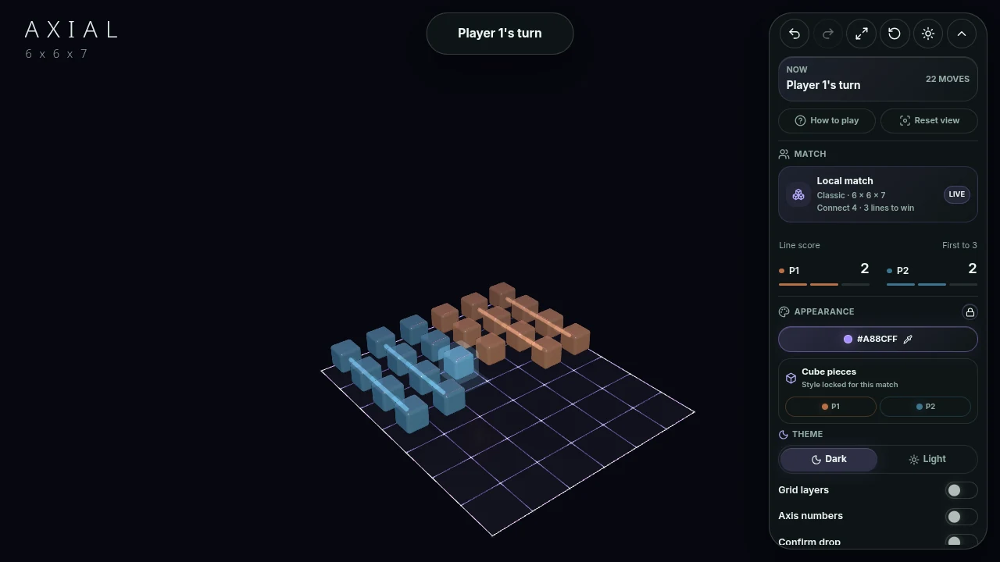

# Axial

A 3D gravity strategy game by Caden Calderon. Drop pieces into a shared board and build lines across its width, height, and depth. Play against the AI, pass the device to a friend, or invite someone to a private online match.

**[Play Axial](https://playaxial.dev)** · [Run locally](#run-locally) · [Engineering guide](axial-web/README.md)



## The game

Axial takes the familiar idea of Connect Four into three dimensions. Pieces fall to the bottom of a column, so every move changes both the current threats and the spaces your opponent can reach next.

- **Three ways to play:** local two-player, four AI difficulties, and private online rooms with invite links and QR codes.
- **Adjustable rules:** Connect 4 or 5, different board dimensions, and one, two, or three lines needed to win. All 13 spatial line directions count.
- **A board you can explore:** orbit and zoom, preview a placement, and use keyboard controls or touch confirmation.
- **Built for another round:** saved local/AI matches, undo and move review, online reconnect, and rematches that alternate the opening player.
- **A considered interface:** interactive onboarding, light/dark themes, reduced-motion support, and optional procedural sound.

Classic is the playable ruleset. Tactical is marked “Coming soon” in the interface; its experimental rules remain in the source.

## Engineering

The active application is a TypeScript workspace built with **SvelteKit, Svelte 5, Three.js, and Threlte**. The frontend runs on Cloudflare Pages; private multiplayer uses a separate Cloudflare Worker with a Durable Object per room.

The implementation separates three concerns:

- **Rules are shared.** A pure TypeScript core owns gravity, legal moves, line scoring, and replay. Both the browser and multiplayer server use it.
- **AI stays off the UI thread.** A cancellable Web Worker runs a hybrid of Monte Carlo tree search, bounded alpha-beta lookahead, and threat evaluation. Difficulty changes the search budget and tactical behavior. The browser AI does not require an LLM or a hosted inference service.
- **Online matches have one authority.** The room server validates moves and broadcasts ordered snapshots; clients recover through reconnect and state synchronization.

For a code tour, start with the [rules engine](axial-web/packages/core/src/index.ts), [AI search](axial-web/packages/ai/src/classic/mcts.ts), [game controller](axial-web/apps/web/src/lib/game/state/gameController.svelte.ts), and [multiplayer room](axial-web/apps/multiplayer-worker/src/roomObject.ts). The [product brief](PRODUCT.md) describes the interaction and visual priorities.

## Run locally

Use Node **24.13.0** (pinned in `axial-web/.node-version`) and pnpm **10.32.1** (pinned in `axial-web/package.json`).

```sh
git clone https://github.com/caden-calderon/Axial.git
cd Axial/axial-web
pnpm install --frozen-lockfile
pnpm dev --host 127.0.0.1
```

Open the URL printed by Vite. Local and AI play work without accounts, API keys, or a backend. To test private Online rooms, start the local room service using the [multiplayer setup instructions](axial-web/README.md#run-locally).

## Verification

From `axial-web/`:

```sh
pnpm check
pnpm lint
pnpm test
pnpm build
```

The test command runs unit tests and Playwright browser tests against a production preview, with a local room service. Tests cover the rules engine, AI tactics and lifecycle, input and onboarding, rendered board behavior, iframe integration, and online matches. The browser suite installs Chromium and needs local ports 4173 and 8787; use a Linux environment with Chromium's system dependencies available. See the [engineering guide](axial-web/README.md#verification) for focused commands and optional AI evaluations.

## Repository map

| Path                                              | Contents                                                                      |
| ------------------------------------------------- | ----------------------------------------------------------------------------- |
| [`axial-web/`](axial-web/)                        | Active web application, shared game/AI packages, and multiplayer service      |
| [`dev/`](dev/README.md)                           | Index of current work, engineering decisions, and dated verification evidence |
| [`main/`](main/)                                  | Preserved Python AI engine and Unity-facing server from the original version  |
| [`Training/`](Training/) and [`Old/`](Old/)       | Earlier AI training experiments and implementations                           |
| [`Context/`](Context/) and [`Reports/`](Reports/) | Original project background and academic reports                              |

Axial began as a Unity game with hand-tracking input and a Python AI opponent. The browser version is the current product. Historical Python experiments are retained for reference and are not dependencies of the web app. The original Unity project is preserved separately and is not included in a Git clone of this repository.

The [original Unity and AI reports](docs/papers/README.md) document that earlier version.

## Credits and licensing

Created by [Caden Calderon](https://github.com/caden-calderon). The interface uses the locally bundled [Inter typeface](axial-web/apps/web/static/fonts/README.md), with its SIL Open Font License included. Third-party dependencies retain their own licenses. A project-wide license has not yet been selected.
