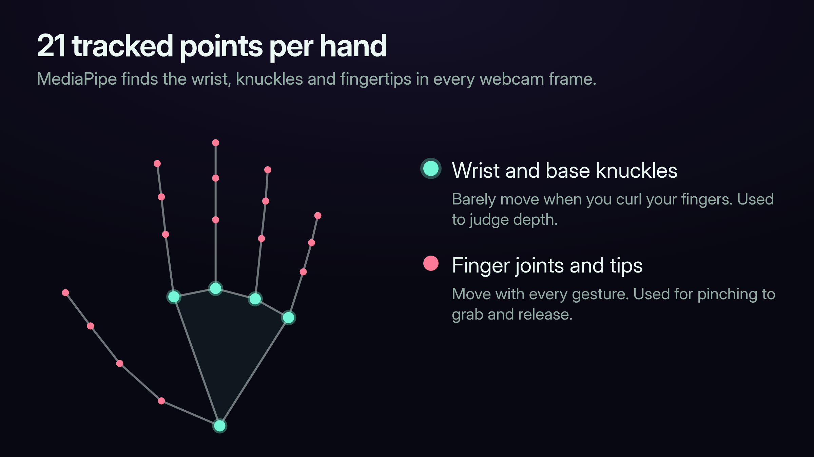
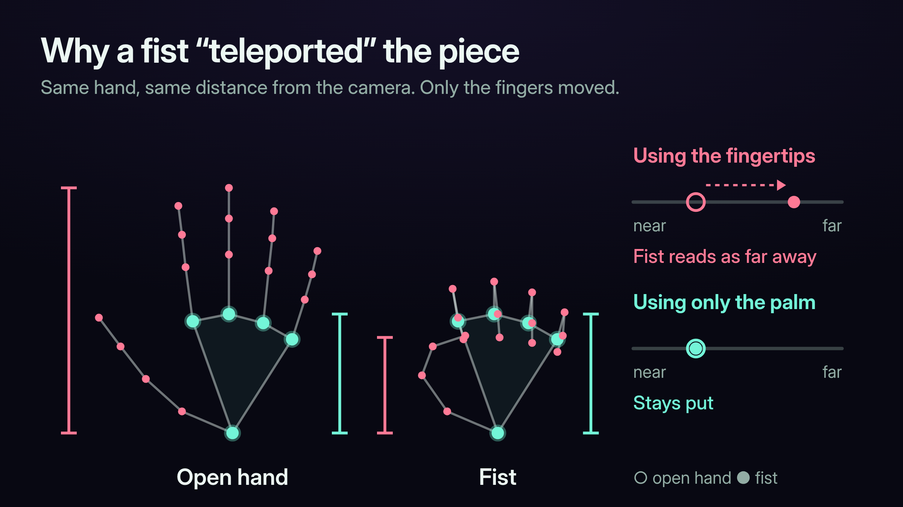
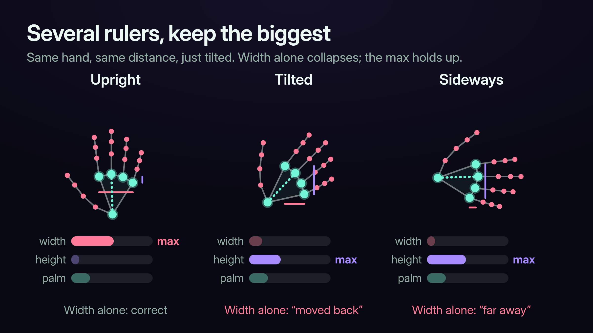
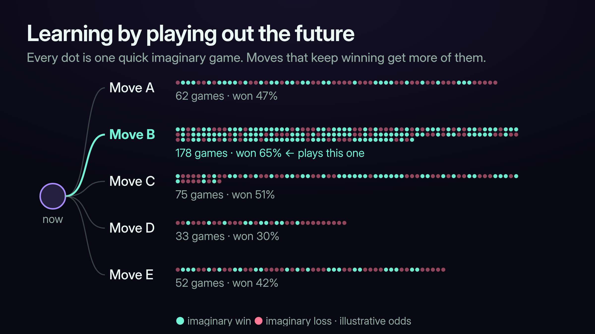

# Axial: From a Hand-Controlled Unity Game to the Browser

[VIDEO: browser trailer]

Hey, it's been a while. I wanted to come back on here with a project I finished a while ago and never actually shared.

This is Axial: Connect Four in three dimensions. You drop pieces into a 3D board, gravity pulls them to the bottom of their column, and you try to line up four: across, up through a stack, or diagonally straight through the volume. Rotate the board and a position that looked harmless suddenly has a threat you completely missed.

The first version was a Unity game you played with your hands. No mouse, no keyboard, just a regular webcam. Pinch a piece to pick it up, move it over the board, and let go to drop it. Hold the board with one hand and drag with the other to spin it around.

[VIDEO: ../../../docs/media/article/unity-grab-drop.mp4] *Grabbing a piece with a pinch and dropping it into the board, from my original class demo. The red skeleton is the tracked hand.*

I recently rebuilt it for the browser so anyone can play from a link: [playaxial.dev](https://playaxial.dev). Coming back to it reminded me how much went into the original, so this is the story of both.

## Reaching into a webcam

[VIDEO: ../../../docs/media/article/unity-rotate.mp4] *Holding the board with one hand and rotating it with the other.*

The hand tracking comes from Google's [MediaPipe](https://developers.google.com/edge/mediapipe/solutions/vision/hand_landmarker/python), which finds 21 points on each hand in the webcam image: the wrist, the knuckles and the fingertips. Picture a moving skeleton drawn over the video. MediaPipe tells you where the hand is. Turning that into something that feels like reaching into a board and picking up a piece was my job.

Left and right were easy. Up and down were easy. Depth was the hard part.

A webcam gives you a flat image. To reach the back rows of the board you move your hand toward or away from the camera, and the image doesn't directly tell you how far away your hand is. MediaPipe does give each point a depth, but it's measured relative to the wrist, so it describes the shape of the hand, not where the hand is.

My idea was to use apparent size. A hand close to the camera looks big, and a hand farther away looks small. Simple, right?

Not quite. A hand can also look smaller without moving at all. Curl your fingers and the distance from your wrist to your fingertips shrinks. Make a fist and the whole outline gets smaller. My early versions couldn't tell the difference, so making a fist would "teleport" your hand to the back of the board. The exact motion you used to grab a piece could send it flying away from you.

I tried eight different ways of measuring hand size before one held up.

The first fix was to stop measuring the fingers. The wrist and the knuckles at the base of each finger barely move when you curl your fingers, so I measured the palm from those points only. That separated the part of the hand used for depth from the part used for grabbing.

Then rotation caused a second problem. Imagine holding a ruler horizontally in front of a camera, then turning it upright without moving it any farther away. Its left-to-right width shrinks to almost nothing, even though the ruler didn't get any shorter. Its length just runs vertically now. The same thing happens when you tilt your hand side to side in a wave, palm still facing the camera. A measurement that only watches horizontal palm width reads that tilt as your hand moving away.

The version that worked, which I called PalmMaxDimension, takes three measurements of the palm: the horizontal span between the index and pinky knuckles, the vertical span between those same two knuckles, and the distance from the wrist to the middle knuckle. Each has its own expected range, so I scaled them all onto the same 0-to-1 scale, which keeps a naturally longer measurement from winning automatically. Then I took the largest.

It's like giving the system several rulers. If one collapses as you turn your hand, another still gives a good reading, and taking the maximum lets that one carry the estimate instead of averaging the collapsed one in.

It isn't a perfect depth sensor. Turn your hand completely edge-on and dimensions can still disappear, the same way a playing card looks paper-thin from the side, and different hand sizes still need calibrating. But it made turning your hand and moving your fingers far less likely to send a piece jumping, and that was enough to build a control scheme around a regular webcam.

The rest was about feel. The tracked points jitter a little even when your hand is still, so I blended each new reading with recent ones. Too little smoothing and the piece shakes; too much and it lags behind you. A grab starts when your fingers come close together but only ends once they separate farther apart, so a pinch sitting right at the edge doesn't flicker between grab and release. Pieces glow when they're in reach, and a ghost piece shows where yours will land.

It had limits. If the tracker lost sight of your hand for a moment, it dropped whatever you were holding. Smoothing can calm a noisy signal, but it can't fill in one that's missing.

## Building the opponent

The other half of the original project was the AI, a Python program running alongside the Unity game.

On the default board you can have up to 42 legal moves on a turn, and every one of them opens up dozens of replies. There's no checking everything, so I used Monte Carlo Tree Search (MCTS), aka the GOAT of search algorithms.

MCTS learns by playing out the future. The AI plays hundreds or thousands of quick imaginary games from the current position, keeps track of which moves tend to lead to wins, and spends more of its time on the ones that keep looking good. It still checks in on moves it has barely tried, so it doesn't lock onto the first decent idea it finds. (The formula that balances those two pulls is called UCT.) When it's done, it plays the move it explored the most, which favors moves that held up over many games instead of one lucky result.

Pure randomness has a blind spot, though. If the opponent is one move from winning, a random imaginary game probably won't bother to block, and the AI concludes the position is lost when it really just needs a block. So I gave it tactical sense: it checks for immediate wins and forced blocks before searching, tries the most promising moves first, and plays its imaginary games with a bias toward winning, blocking and building threats.

All of that only works if the AI can play a lot of imaginary games quickly. I stored the 3D board as a flat strip of bytes in a NumPy array, one byte per cell with each column stored together, and used Numba to compile the busiest loops (dropping pieces, checking wins, playing out games) into machine code instead of running them step by step in Python.

It also didn't throw away its homework. If you played a move the AI had already explored, it kept that part of its search and picked up from there on the next turn. Think of it as keeping your notes on the position you actually reached instead of tossing the whole notebook after every move.

Unity handled the scene and the hands, and Python handled the AI and the official game state. They talked over a local connection, so the game kept running smoothly while the opponent thought.

## Bringing it to the browser

The catch with the original was that nobody could just try it. You needed the Unity game, the Python server and a webcam all set up. So I came back to Axial with one goal: open a link and play.

The browser version is a full rebuild in SvelteKit, TypeScript, Three.js and Threlte. It uses mouse and touch instead of hand tracking (the hands stayed with the Unity version). You can play the AI, take turns with someone on the same device, or invite a friend to a private online game. Browser play and online multiplayer were both on the "future work" list in my original report, so it's satisfying to finally check them off.

[IMAGE: match settings / multi-line match]

It also gives you more ways to play. You can grow the board up to 10 spaces in any direction, switch to connect five, or require two or three lines to win. In a multi-line match your first line doesn't end the game. You keep playing on the same board, building your next line while stopping your opponent's.

The AI is rebuilt in TypeScript around the same MCTS-plus-tactics core, with some real upgrades:

- **It looks ahead more directly.** Alongside the imaginary games, it uses alpha-beta search, which works through specific sequences of moves while assuming you'll pick your best reply. Think: "this looks good, but what's their best answer?" It skips branches once they can't change its decision.
- **It understands the new rules.** In a three-line match, finishing one line is progress, not a win, so it has to weigh that against what it hands you next. Gravity adds traps too: a useful piece can also be the support your opponent needs to land a winning piece right on top of it.
- **It knows when to stop.** Long matches make full imaginary games expensive, so it can stop one partway, judge the unfinished position, and spend the time it saved exploring other options.

The AI also runs in a Web Worker, separate from the page itself, so you can keep rotating and inspecting the board while it thinks. Same idea as the separate Python process, just inside your browser.

## Try it

Across both versions the hard part was the same: making the technical work disappear into something that feels good to play. Hands that stay steady without feeling sluggish, and an opponent that thinks hard without freezing the game.

If you want the full details, I wrote two papers on the original project:

- [**Axial: A 3D Strategy Game with Gesture-Based Hand Tracking Controls**](https://github.com/caden-calderon/Axial/blob/main/docs/papers/01-Axial-Game-and-Hand-Tracking.pdf): the Unity game, the depth experiments, gestures, smoothing and interaction design.
- [**Monte Carlo Tree Search for 3D Connect Four**](https://github.com/caden-calderon/Axial/blob/main/docs/papers/02-Axial-AI-and-MCTS.pdf): the original Python opponent, its search, tactics and optimization.

They cover the 2025 Unity/Python version; the browser rebuild came later.

Play at [playaxial.dev](https://playaxial.dev), and the code is on [GitHub](https://github.com/caden-calderon/Axial).

I'd love to hear what you think, whether you play a match or dig into the code. I've got a bunch of other projects I'll be sharing soon, too. Feel free to connect here, or follow me on X at [@caden_calderon](https://x.com/caden_calderon).
